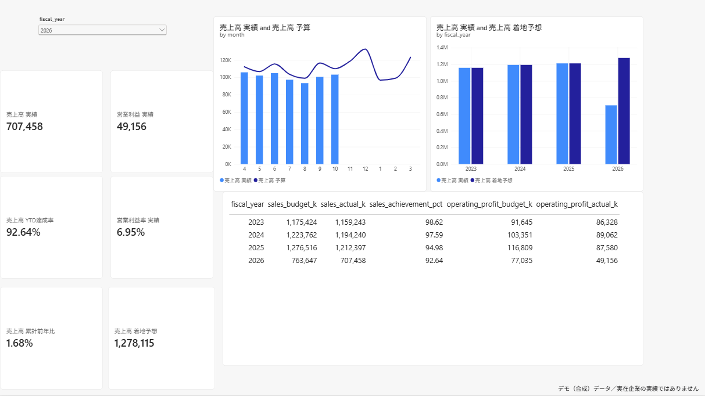
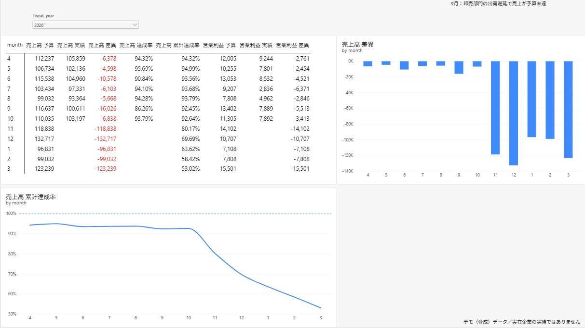
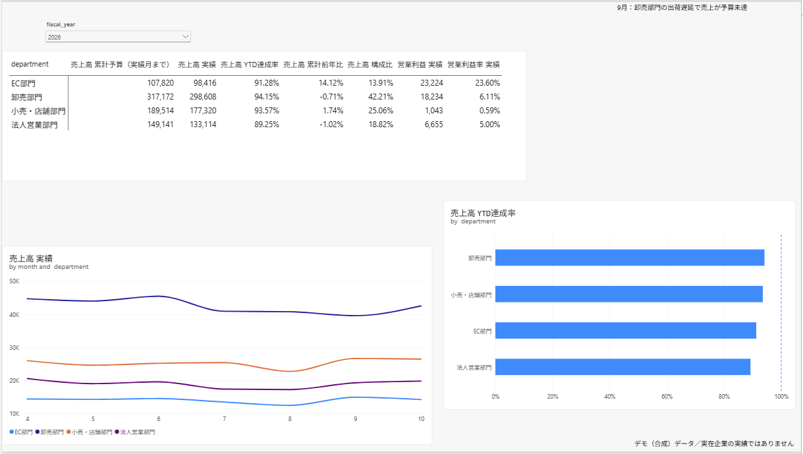
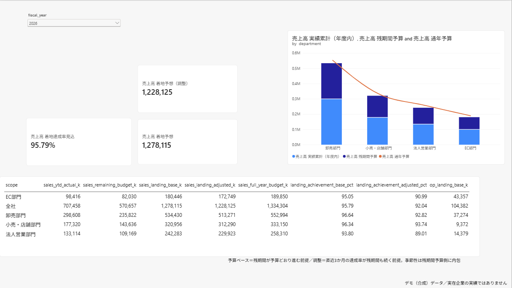

# 経営KPI・予実管理ダッシュボード

中小企業の月次PLを題材に、「売上・利益の予算vs実績＋KPI＋着地予想」を見る経営ダッシュボードのサンプルです。Excel完成品（日本語版・英語版）、Power BI設計パック、整形済みCSV、データ生成スクリプトを含みます。

> ⚠ **本リポジトリの数値はすべてデモ（合成）データです。** 題材は架空の企業であり、実在企業の実績ではありません。生成ルールは `scripts/generate_data.py` に全量公開しており、乱数シード固定で完全に再現できます。

📖 Zenn 記事： https://zenn.dev/halu_git/articles/3af5c7234d6b5d

## 主な数値（2026年度・2026年10月時点）

- 売上高実績（4〜10月累計）： **707,458千円**／予算達成率 **92.6%**／前年同期比 **+1.7%**
- 営業利益（実績）： **49,156千円**（利益率6.9%）
- 売上着地予想： **1,278,115千円**（予算ベース、通年予算比95.8%）／達成率調整シナリオ 1,228,125千円（同92.0%）
- 部門別達成率： 卸売94.2%／小売・店舗93.6%／EC 91.3%（前年比+14.1%で最速成長だが予算前提がさらに高い）／法人営業89.3%
- 小売・店舗部門の営業利益率は0.6%まで低下（利益面の課題部門）

## 構成

- `excel/management_kpi_dashboard.xlsx` ― Excel完成品（11シート、ネイティブグラフ7点）
- `excel/management_kpi_dashboard_en.xlsx` ― 英語版Excel（数値は日本語版と同一・全数値セル突合済み）
- `powerbi/` ― Power BI設計パック（model.md / measures.dax / pages.md、4ページ設計、着地予想メジャー含む）＋実装済みスクリーンショット（images/）＋組み立て記録（BUILD_NOTES.md）
- `data/processed/` ― tidy形式CSV 4ファイル（月次PL 部門別／全社、年度サマリー、着地予想）
- `scripts/` ― データ生成・Excel生成スクリプト（generate_data.py / build_excel.py / build_excel_en.py）
- `design.md` ― 設計メモ（目的・データ設計・採用/不採用理由・検証結果）

## データについて

### なぜ合成データなのか

予実管理ダッシュボードの見本には「月次×部門×予算・実績」の粒度の企業PLが必要ですが、実在企業のその粒度のデータは非公開で、入手も公開もできません。そのため、生成ルールを公開した合成データを使い、数値の作られ方を検証可能にしています。

### 検討したが採用しなかったデータ

- **上場企業の決算データ（決算短信・EDINET）**： 予算に相当するのは年次の業績予想のみで、月次・部門別の予算と実績の対比は作れません。また実在企業名を販売用サンプルの題材に使うこと自体が不適切なため不採用
- **法人企業統計（財務省）**： 四半期・業種別集計で予算の概念がなく、1社の月次予実管理の形になりません
- **GA4デモアカウント等の公開デモデータ**： ECの行動データのみで、原価・販管費を含むPL構造を持ちません（売上・ECダッシュボードのサンプルでは有力な候補）

### 生成ルールの要約

- 架空企業「株式会社サンプル商事」（卸・小売、従業員32名）、4部門（卸売／小売・店舗／EC／法人営業）、勘定は売上高・売上原価・販管費
- 季節性（12月ピーク・8月落ち込み）、部門別成長トレンド、予算ストレッチ（予算が実勢より年々やや高め）、原価率ドリフト、販管費の固定費＋12月賞与
- 異常値イベント： 大口受注（2024年6月）、大規模返品（2025年2月）、ECキャンペーン成功（2025年8月）、大口顧客の喪失（2026年5月〜）、出荷遅延（2026年9〜10月）、広告費（2025年11月）、店舗改装費（2026年7月）
- 乱数シード： 20261116（再実行で完全再現可能）

### 定義・計算式

- 会計年度は4月〜翌3月。粗利＝売上高−売上原価、営業利益＝粗利−販管費。予算達成率＝実績÷予算
- 前年比は前年度の同期比較（2026年度は4〜10月累計同士）
- 着地予想（予算ベース）＝実績累計＋残期間予算／着地予想（達成率調整）＝実績累計＋残期間予算×直近3か月（8〜10月）の売上達成率
- 金額の単位は千円

## 検証

- 部門別CSV→全社集計の再現（288セル）、年度サマリー再現（120セル）、着地予想再現（45セル）、ダッシュボード表示値照合（4件）： いずれも不一致0（各Excelの「検証ログ」シートに記録）
- 英語版との数値突合： 4,030セル全件一致・不一致0、未翻訳文字列0（英語版の検証ログに記録）

## Power BI 実装（2026-11-19 組み立て完了）

設計パックどおりに Power BI Desktop で組み立て、Excel版と全数値を照合済みです（.pbix 本体は希望者に提供します）。

**ページ1：KPI概要**

**ページ2：予実対比**

**ページ3：部門別**

**ページ4：着地予想**

## 実務での使い方

会計ソフト（freee／マネーフォワード等）の月次PLエクスポートと予算マスタを、`monthly_pl_by_department.csv` と同じ列構成に整形して差し替えれば、同じダッシュボードが実データで動きます。差し替え手順は `powerbi/measures.dax` の末尾に記載しています。

---

## English summary

**Management KPI / Budget-vs-Actual Dashboard** — a sample business dashboard built on the monthly P/L of a fictional SME (wholesale/retail, 32 employees, 4 departments): sales & profit budget vs. actual, KPI overview, department breakdown, and a full-year landing forecast in two scenarios (budget-based / achievement-adjusted).

> ⚠ All figures are **demo (synthetic) data** — not the results of any real company. Generation rules are fully documented in `scripts/generate_data.py` (fixed seed, fully reproducible). Real company P/L data at monthly × department × budget/actual granularity is not public, which is why auditable synthetic data is used; listed-company filings, government corporate statistics and the GA4 demo account were considered and rejected for the reasons documented in `design.md` and the workbooks' Sources & Notes sheets.

Key figures (FY2026, as of Oct 2026): sales actual (Apr–Oct) ¥707,458k, budget achievement 92.6%, YoY +1.7%, operating profit ¥49,156k (6.9% margin), sales landing forecast ¥1,278,115k (95.8% of the full-year budget). English reports are available — this sample itself is delivered bilingually: the English Excel edition contains identical figures (all 4,030 numeric cells cross-checked, zero mismatches).

The Power BI version has also been built in Power BI Desktop following the design pack (4 pages: KPI overview / budget vs. actual / departments / landing forecast), with all figures reconciled against the Excel edition — see the screenshots under `powerbi/images/`. The .pbix file itself is available on request.
